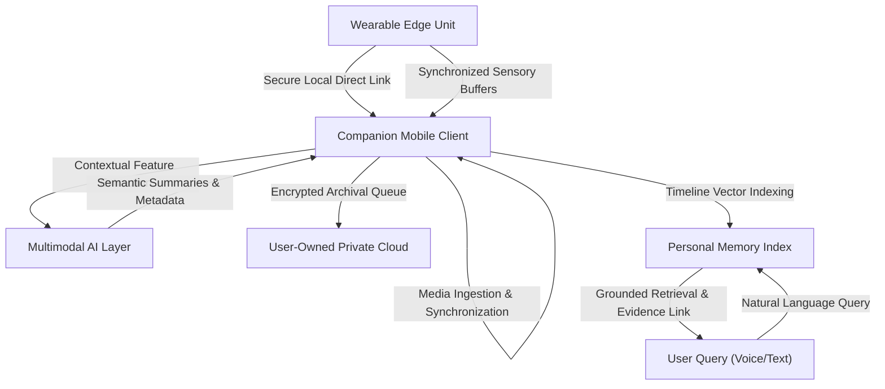

# 🧠 SAGE — Smart AI Guardian Entity
### Personal Wearable Memory Capture & Cognitive Retrieval System

> **"People May Fade. Memories Shouldn't."**

---

## 1. Overview
**SAGE (Smart AI Guardian Entity)** is an advanced personal wearable memory capture and cognitive retrieval system. By combining an ultra-low-power wearable capture unit with a cross-platform companion application and a multimodal AI indexing pipeline, SAGE continuously documents, categorizes, and indexes daily life events into an interactive, queryable personal timeline.

---

## 2. Problem Statement
Human memory is fallible: we forget where we place essential items, lose track of meeting action items, and fail to retain nuanced details from our daily routines. While conventional recording devices capture massive volumes of raw data, they produce unindexed, monolithic files that require tedious manual review.

---

## 3. The SAGE Solution
SAGE operates as a **wearable cognitive co-processor**:
*   **Hands-Free Contextual Capture:** Records synchronized sensory segments without user intervention.
*   **Decoupled Edge Architecture:** Avoids microcontroller processing bottlenecks by isolating sensor collection from media muxing.
*   **Semantic Timeline Mapping:** Transforms raw sensory streams into structured, searchable personal knowledge.
*   **Conversational Natural Language Recall:** Allows users to query their daily memories naturally (e.g., *"Where did I leave my keys?"* or *"What were my action items from this morning's meeting?"*).

---

## 4. System Architecture

For detailed architectural tier breakdowns, see [Architecture Details](docs/architecture/architecture-details.md).

---

## 5. Hardware Specifications
The SAGE wearable unit is designed for minimal weight, low thermal emission, and extended battery efficiency:
*   **Processing SoC:** Dual-core 32-bit microcontroller with high-speed PSRAM and integrated 2.4GHz wireless.
*   **Visual Sensor:** Ultra-low-power VGA CMOS camera module (OV2640).
*   **Auditory Sensor:** Digital PDM omnidirectional microphone.
*   **Power Subsystem:** Multi-stage dynamic sleep-state management to preserve battery life during passive intervals.

For technical schematics and pin interfacing concepts, see [Hardware Overview](hardware/hardware-overview.md).

---

## 6. Technology Stack

*   **Edge Hardware:** FreeRTOS, ESP32-S3 Architecture, DMA Sensor Interfacing
*   **Companion Mobile Client:** Flutter, Dart, Cross-Platform Android/iOS
*   **Cognitive AI:** Multimodal Foundation Models, RAG Architecture, Semantic Vector Search
*   **Backend & Cloud:** FastAPI, Google Drive API, RESTful Integration
*   **Security & Privacy:** On-device encryption, user-owned storage, private credential scoping

---

## 7. Core Capabilities
*   **Decoupled Dual-Buffer Capture:** Prevents memory exhaustion by isolating visual frame acquisition and audio sampling into independent buffers.
*   **Temporal Timeline Alignment:** Reconciles decoupled sensory streams on the client side, maintaining audio-visual synchronization without microcontroller overhead.
*   **Semantic Memory Graph:** Generates concise titles, contextual summaries, and visual descriptors for every captured event.
*   **Conversational Retrieval (RAG):** Natural language interface that answers personal recall questions and surfaces direct links to supporting media evidence.

---

## 8. Primary Use Cases
1.  **Finding Misplaced Belongings:** Query SAGE to pinpoint the timestamp and video clip showing where an item was last seen.
2.  **Meeting & Discussion Summaries:** Conversational review of meeting action items, commitments, and verbal agreements.
3.  **Automated Personal Journal:** Continuous, structured timeline of daily activities with automated contextual categorization.

For expanded scenario workflows, see [Use Cases](docs/use-cases/use-cases-details.md).

---

## 9. Privacy & Data Ownership
*   **Zero-Knowledge Architecture:** User data is archived directly into the user's private cloud storage rather than centralized third-party servers.
*   **Direct User Control:** Users retain complete authority to inspect, annotate, or permanently purge captured memories.
*   **Local Processing Prioritization:** On-device indexing ensures personal timeline logs remain private and secure.

---

## 10. Research Foundation
*   [Literature Review](research/literature-review.md): Historical evolution of wearable cognitive aids from SenseCam to multimodal AI.
*   [Gap Analysis](research/gap-analysis.md): Examination of memory exhaustion and synchronization bottlenecks in edge computing.
*   [Methodology](research/methodology.md): Formal research methodology for asynchronous capture and grounded semantic recall.

---

## 11. Project Status & Roadmap
- [x] Functional dual-channel sensor acquisition on edge hardware
- [x] Client-side media reconciliation and interactive timeline rendering
- [x] Multimodal event synthesis and conversational retrieval pipeline
- [ ] On-device local embedding generation for offline semantic search
- [ ] Multi-device contextual correlation

---

## 12. Intellectual Property & License
Copyright © 2026 Vinayak Sharma / ByteBastion. All Rights Reserved.

This repository contains academic documentation, research methodologies, and high-level architectural specifications for the SAGE project. The proprietary firmware implementation, synchronization algorithms, and software pipelines are protected under intellectual property law.

For licensing terms, see [LICENSE](LICENSE). For academic collaboration or institutional evaluation, please open a discussion on GitHub.
