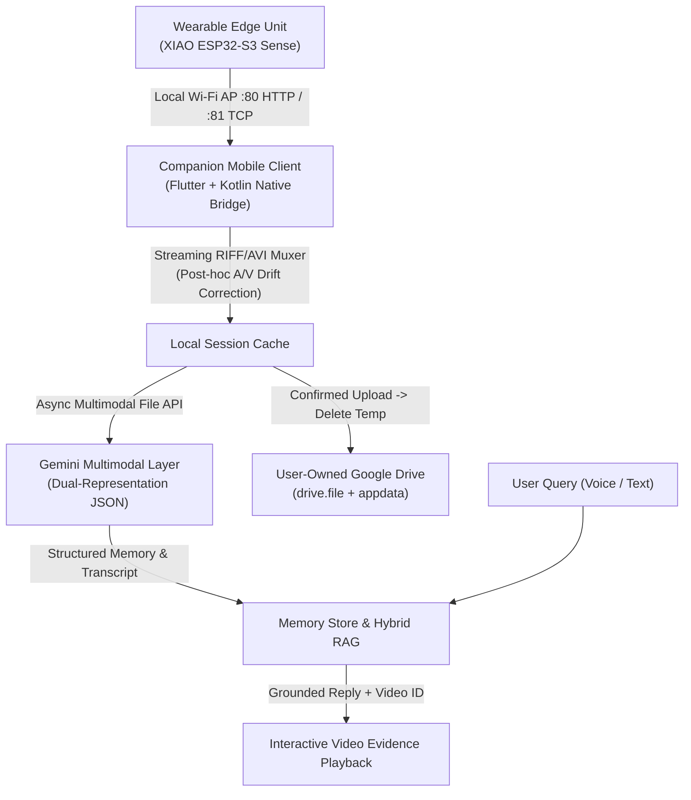

# 🧠 SAGE — Smriti Adaptive Guardian Engine

### Synchronized Multimodal Wearable Memory Capture & Cognitive Retrieval Research

> **"People May Fade. Memories Shouldn't."**

[](#)
[](#)
[](https://github.com/ByteBastion/SAGE-Product)
[-555555)](#sage-ecosystem)
[](LICENSE)

---

## 🌐 SAGE Ecosystem

SAGE is structured across three dedicated repositories separating academic research, public product distribution, and proprietary source code:

| Repository | Visibility | Purpose |
| :--- | :---: | :--- |
| **[ByteBastion/SAGE-AI](https://github.com/ByteBastion/SAGE-AI)** *(this repo)* | 🌐 Public | Academic foundation, 4-agent conceptual architecture, 7-pillar multimodal memory framework, literature review, gap analysis, and pilot evaluation findings. |
| **[ByteBastion/SAGE-Product](https://github.com/ByteBastion/SAGE-Product)** | 🌐 Public | Public product showcase, system diagrams, Android installation guide, hardware setup documentation, privacy/security specs, and compiled APK releases. |
| **ByteBastion/SAGE-Core** | 🔒 Private | Full proprietary implementation (Flutter/Dart application, Kotlin Android native networking/keystore bridge, and ESP32-S3 C++/FreeRTOS firmware). |

> Public documentation and Android releases live in `SAGE-Product` and `SAGE-AI`, while proprietary source code remains protected in `SAGE-Core`.

---

## 1. Overview

**SAGE (Smriti Adaptive Guardian Engine)** is a multimodal wearable memory capture and cognitive retrieval system. By pairing an ultra-compact wearable capture unit with a companion Android application and multimodal foundation model pipeline, SAGE captures real-world audio-visual experiences locally, transforms them into dual-representation memories, and makes daily events queryable through conversational recall.

---

## 2. Problem Statement

Human episodic memory decays rapidly: we misplace everyday objects, forget commitments from conversations, and lose track of nuanced visual and spoken context. Existing wearable lifelogging approaches face a rigid trade-off:
1. **Always-On Cloud Streaming:** Drains compact wearable batteries, fails without cellular/Wi-Fi routers, and raises privacy concerns.
2. **Unindexed Footage Hoarding:** Accumulates hours of raw media without semantic structure—leaving retrieval, not storage, as the bottleneck.

---

## 3. Research Architecture: Four Conceptual Agents & Seven-Pillar Framework

### Conceptual Four-Agent Architecture
1. **Capture Agent:** Acquires continuous visual frames (`640×480` MJPEG) and `16 kHz` PDM audio from the wearable unit over a self-hosted local Wi-Fi Access Point (`SAGE-XIAO`).
2. **Memory Agent:** Processes raw sensor streams into synchronized AVI containers, generates structured episodic summaries, and maintains persistent user/project/document memory vaults.
3. **Recall Agent:** Resolves natural-language voice or text queries against stored memory context and links answers directly to playable video evidence.
4. **Control Agent:** Coordinates identity, OAuth 2.0 user-owned Google Drive storage, device configuration, upload queues, and user-managed API credentials.

### Seven-Pillar Multimodal Memory Framework
SAGE structures multimodal scene analysis across seven analytical dimensions:
1. **Audio Understanding:** Primary/background speech, speaker changes, non-speech vocalizations, and environmental sounds.
2. **Visual Scene Understanding:** Neutral observation of people, clothing, posture, objects, lighting, and camera framing.
3. **Off-Camera Events:** Capturing acoustic events occurring outside the camera's field of view without hallucinating visual sources.
4. **Persistent Video Memory:** Timestamped entity references (`Person_01`, `OBJ_001`), spatial relations, and state transitions.
5. **Audio-Visual Fusion:** Distinguishing direct visual observation, direct audio observation, supported inference, and unresolved uncertainty.
6. **Temporal Accuracy:** Preserving exact event chronology across pans, speaker turns, and scene shifts.
7. **Structured Chronological Description:** Dual-output synthesis producing both a calm **`human_memory`** narrative (accessible for users with memory difficulties) and an evidence-grounded **`reconstruction_blueprint`**.

---

## 4. System Architecture



For detailed architectural breakdowns, see [docs/architecture/architecture-details.md](docs/architecture/architecture-details.md).

---

## 5. Hardware Architecture Summary

* **Compute SoC:** Seeed Studio XIAO ESP32-S3 Sense (Xtensa LX7 dual-core @ 240 MHz, 8 MB PSRAM, 8 MB Flash, integrated 2.4 GHz Wi-Fi).
* **Visual Sensor:** OV2640 CMOS camera configured for VGA (`640×480`) JPEG frame capture into PSRAM buffers.
* **Auditory Sensor:** Digital PDM microphone interfaced via I2S (`16 kHz`, 16-bit mono PCM with 8x digital gain and clipping guard).
* **Dual-Core Partitioning:** Core 1 serves HTTP control & live frames (`:80`), while Core 0 executes a pinned FreeRTOS task streaming I2S audio (`:81`) to eliminate bus contention.

For hardware details, see [hardware/hardware-overview.md](hardware/hardware-overview.md).

---

## 6. Implementation Status vs. Proposed Research Roadmap

| Subsystem | Current Status | Notes |
| :--- | :---: | :--- |
| **ESP32-S3 Dual-Core Firmware (v3.0.0)** | **Implemented** | SoftAP `SAGE-XIAO`, HTTP `:80`, TCP I2S audio `:81`, 45s heartbeat watchdog. |
| **Android Native Wi-Fi Binding & Socket Proxy** | **Implemented** | Kotlin `WifiNetworkSpecifier` + `bindProcessToNetwork()` + native HTTP proxy. |
| **Streaming AVI Muxer + Post-Hoc Sync** | **Implemented** | Interleaved `00dc`/`01wb` chunks, `idx1` index, dynamic rate/scale header rewrite. |
| **7-Pillar Multimodal Video Understanding** | **Implemented** | Gemini File API pipeline returning dual `human_memory` + `reconstruction_blueprint` JSON. |
| **Conversational Recall & Attachment RAG** | **Partially Implemented** | Implemented via hybrid token-overlap scoring + LLM context injection; **semantic vector embeddings are Planned**. |
| **User-Owned Cloud Sync & Custody** | **Implemented** | Google Drive `drive.file` + `appDataFolder` sync with tombstone merges and delete-after-upload safety. |
| **FastAPI OAuth Backend Proxy** | **Experimental** | Prototyped in early commits; current mobile build handles OAuth via `google_sign_in` and encrypted Android Keystore BYOK API storage. |
| **On-Device Encryption, Face-Blur & Sleep States** | **Planned** | Local vaults use standard OS app storage today; cryptographic local storage, bystander face-blurring, and dynamic firmware sleep states are planned for Phase 2. |

---

## 7. Pilot Evaluation Findings

Preliminary pilot tests reported in the SAGE evaluation manuscript demonstrated:
* **Wireless Link Stability:** `0 / 20` accidental disconnections across 20 indoor test sessions (2.4 GHz, 3–10 m range) using the 48s connection failure tolerance; `38–72 ms` frame round-trip latency and `13–26 fps` live viewfinder throughput.
* **Audio-Visual Synchronization:** Post-hoc AVI header rate/scale correction maintained A/V alignment drift under `< 40 ms` on 15-second clips (well below the ~80 ms human perceptual threshold).
* **Multimodal Scene Extraction:** Across 10 diverse 15-second clips, prominent people and objects were identified in `10 / 10` clips, structured JSON parsed on the first attempt in `9 / 10` runs (1 retry), and average cloud processing latency measured `~47 s`.
* **Conversational Recall:** Across 20 natural-language queries over a 10-session archive, Recall retrieved the correct matching video ID in `17 / 20` queries (`85%` precision). All 3 misses targeted brief secondary passing details, highlighting summary granularity and future vector indexing as key improvement levers.

> *Scope Note:* These measurements represent a team-conducted pilot evaluation and are presented strictly as preliminary system validation rather than a large-scale clinical or multi-user benchmark.

---

## 8. Research Foundation & Navigation

* [Literature Review](research/literature-review.md) & [Literature Details](docs/literature-review/literature-details.md) — Evolution from SenseCam and MemoryGlasses to multimodal AI.
* [Gap Analysis](research/gap-analysis.md) & [Gap Details](docs/gap-analysis/gap-details.md) — Single-core contention, PSRAM limits, and microcontroller muxing bottlenecks.
* [Methodology](research/methodology.md) & [Methodology Details](docs/methodology/methodology-details.md) — Asynchronous capture, temporal metadata reconciliation, and retrieval pipeline.
* [Objectives](docs/objectives/objectives-details.md) — Functional and technical system targets.
* [Use Cases](docs/use-cases/use-cases-details.md) — Memory assistance, lecture/meeting recall, and personal timeline navigation.

---

## 9. Citation

If referencing this research framework or system architecture in academic work, please cite:

```bibtex
@misc{sharma2026sage,
  title  = {SAGE: Smriti Adaptive Guardian Engine — A Synchronized Multimodal Wearable Memory Capture and Conversational Retrieval System},
  author = {Sharma, Vinayak and Bhatia, Tanya},
  year   = {2026},
  note   = {School of Engineering \& Technology, K.R. Mangalam University, Gurugram, India},
  url    = {https://github.com/ByteBastion/SAGE-AI}
}
```

---

## 10. License

This repository is licensed under the [MIT License](LICENSE) (`Copyright © 2026 Vinayak Sharma (ByteBastion)`).

This repository preserves the research methodology, theoretical architecture, and academic documentation for SAGE. For the public Android release and product documentation, visit **[ByteBastion/SAGE-Product](https://github.com/ByteBastion/SAGE-Product)**.
